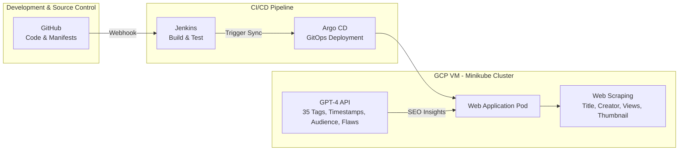
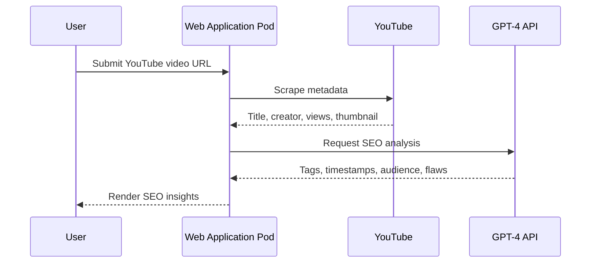
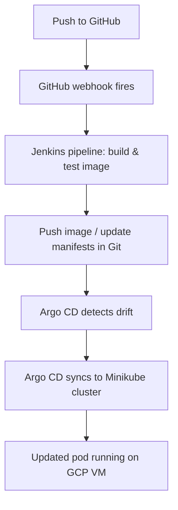

<div align="center">

# TubeRank AI

### YouTube SEO Insights Generator on a GitOps Pipeline

AI-driven YouTube SEO analysis, delivered through a push-to-deploy GitOps workflow built on Jenkins, Argo CD, and Kubernetes.


</div>

---

> **Repository status:** This repository currently contains project documentation and the architecture
> reference only. Application source, container, and Kubernetes manifests are not yet committed here.
> Commands below marked _(expected)_ describe the standard workflow for this stack and should be
> adjusted to match the source once it lands in the repo.

## Overview

TubeRank AI analyzes a YouTube video and produces actionable SEO recommendations. The application
scrapes public video metadata (title, creator, views, thumbnail) and sends it to the OpenAI GPT-4 API,
which returns SEO insights including tag suggestions, timestamps, target audience, and content flaws.

The project is designed around a GitOps delivery model. Changes pushed to GitHub trigger a Jenkins
pipeline that builds and tests the container image, and Argo CD continuously syncs the declared state
from Git into a Kubernetes cluster. The cluster runs as Minikube on a Google Cloud (GCP) virtual machine.

## Features

Verified from the architecture reference and project description:

- **YouTube metadata scraping** - extracts title, creator, view count, and thumbnail from a target video.
- **GPT-4 SEO insights** - generates SEO tags, timestamps, target-audience analysis, and content flaws.
- **Web interface** - the analysis is exposed through a web application pod running in the cluster.
- **CI with Jenkins** - build and test stage triggered by a GitHub webhook on push.
- **GitOps CD with Argo CD** - Git is the source of truth; Argo CD syncs manifests into the cluster.
- **Kubernetes deployment** - the app runs as a pod in a Minikube cluster hosted on a GCP VM.

## Tech Stack

| Layer | Technology |
| --- | --- |
| Application | Python, Streamlit |
| AI | OpenAI GPT-4 API |
| Data source | YouTube public metadata (web scraping) |
| Containerization | Docker |
| Continuous Integration | Jenkins |
| Continuous Delivery | Argo CD (GitOps) |
| Orchestration | Kubernetes (Minikube) |
| Source Control | GitHub (with webhook to Jenkins) |
| Infrastructure | Google Cloud Platform VM |

## Architecture



## Request Workflow



## Deployment Workflow



## Prerequisites

- Python 3.x and `pip`
- An OpenAI API key with GPT-4 access
- Docker
- A Kubernetes cluster (Minikube)
- `kubectl`
- Jenkins (for CI)
- Argo CD (for CD)
- A GCP VM to host the cluster (for the deployed environment)

## Installation

> _(expected)_ Run against the application source once it is present in this repository.

```bash
# 1. Clone the repository
git clone <repository-url>
cd "TubeRank AI"

# 2. Create and activate a virtual environment
python -m venv venv
source venv/bin/activate      # Windows: venv\Scripts\activate

# 3. Install dependencies (requires a requirements file in the repo)
pip install -r requirements.txt
```

## Environment Variables

The application requires an OpenAI API key to call GPT-4. Provide it through the environment:

| Variable | Description |
| --- | --- |
| `OPENAI_API_KEY` | OpenAI API key used to authenticate GPT-4 requests. |

> Configure any additional variables to match the application source. Do not commit secrets to Git;
> inject the key through a Kubernetes Secret in the cluster.

## Development

> _(expected)_ Streamlit is the application framework shown in the stack.

```bash
# Run the app locally
streamlit run app.py
```

```bash
# Build the container image
docker build -t tuberank-ai .

# Run the container locally
docker run -p 8501:8501 --env OPENAI_API_KEY=$OPENAI_API_KEY tuberank-ai
```

## Deployment

This project follows a GitOps model. The cluster state is declared in Git and reconciled by Argo CD.

```bash
# Start a local Minikube cluster (on the GCP VM)
minikube start

# Apply Kubernetes manifests (source of truth tracked by Argo CD)
kubectl apply -f k8s/

# Inspect running workloads
kubectl get pods
kubectl get svc
```

Delivery flow:

1. Push code or manifest changes to GitHub.
2. A GitHub webhook triggers the Jenkins build-and-test pipeline.
3. Jenkins publishes the image and updates the manifests in Git.
4. Argo CD detects the change and syncs the desired state into the Minikube cluster.
5. The updated web application pod serves traffic from the GCP VM.
