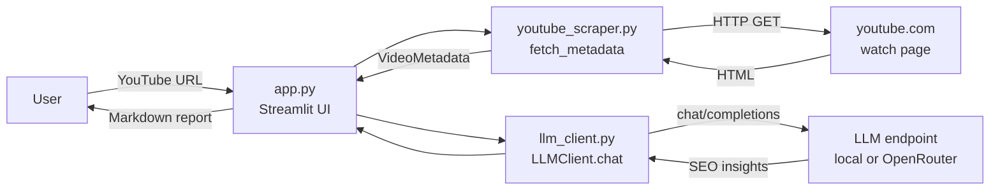
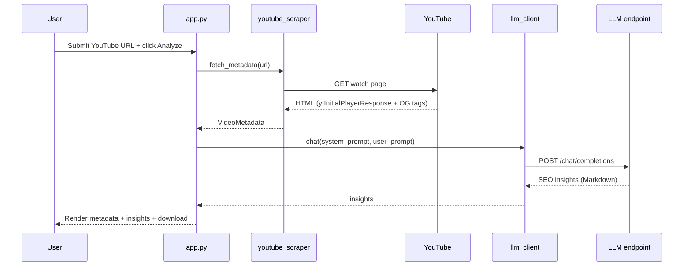

<div align="center">

# TubeRank AI

### YouTube SEO Insights Generator

Paste a YouTube URL, scrape its public metadata, and generate actionable SEO insights with a provider-agnostic LLM client. Runs against a local model (Ollama) or OpenRouter.


</div>

---

## Overview

TubeRank AI is a Streamlit web app that analyzes a single YouTube video and returns structured SEO recommendations.

It scrapes the public watch page with `requests` and `BeautifulSoup` (parsing the embedded `ytInitialPlayerResponse` payload and OpenGraph tags), builds a prompt from the extracted metadata, and sends it to an OpenAI-compatible chat completions endpoint. The LLM client is provider-agnostic: point it at a local runtime such as Ollama, or at OpenRouter, through environment variables.

The model returns a Markdown report with four fixed sections: SEO tags, suggested timestamps, target audience, and content flaws with improvements. The report can be downloaded directly from the UI.

## Features

- Accepts standard watch URLs, `youtu.be` links, Shorts, embed, `/live/`, and bare 11-character video IDs.
- Scrapes title, channel, view count, length, publish date, thumbnail, description, and existing keywords without the YouTube Data API.
- Provider-agnostic LLM client supporting `local` (Ollama-compatible) and `openrouter` backends.
- Generates a Markdown report: at least 35 SEO tags, suggested chapter timestamps, target audience, and content flaws with fixes.
- Renders video metadata and thumbnail in the UI, with a one-click Markdown download of the insights.
- Containerized with Docker, built with `uv`, and ships a Streamlit health check.

## Tech Stack

| Layer | Technology |
| --- | --- |
| Language | Python >= 3.10 |
| Web UI | Streamlit 1.40.2 |
| Scraping | requests 2.32.3, beautifulsoup4 4.12.3 |
| Config | python-dotenv 1.0.1 |
| LLM backends | Local (Ollama-compatible), OpenRouter (OpenAI-compatible chat completions) |
| Packaging | pyproject.toml, uv |
| Container | Docker (python:3.12-slim) |

## Architecture



## Request Workflow



## Prerequisites

- Python 3.10 or newer, with `pip` (or [uv](https://docs.astral.sh/uv/))
- One LLM backend:
  - Local: an Ollama-compatible runtime exposing an OpenAI-style API at `http://localhost:11434/v1`, or
  - OpenRouter: an API key from [openrouter.ai/keys](https://openrouter.ai/keys)
- Docker (optional, for containerized runs)

## Installation

```bash
# 1. Clone the repository
git clone <repository-url>
cd TubeRank-AI

# 2. Create and activate a virtual environment
python -m venv .venv
.venv\Scripts\activate        # Windows (PowerShell)
# source .venv/bin/activate   # macOS / Linux

# 3. Install dependencies
pip install -r requirements.txt

# 4. Create your environment file
copy .env.example .env         # Windows
# cp .env.example .env         # macOS / Linux
```

## Environment Variables

Configuration is read from the environment (loaded from `.env` via python-dotenv). Defaults come from the code.

| Variable | Default | Description |
| --- | --- | --- |
| `LLM_PROVIDER` | `local` | Backend to use: `local` or `openrouter`. |
| `LLM_MODEL` | `llama3.1` | Model name passed to the chat completions request. |
| `LLM_TEMPERATURE` | `0.4` | Sampling temperature. |
| `LLM_TIMEOUT` | `120` | Request timeout in seconds. |
| `LLM_API_KEY` | (empty) | API key. Required when `LLM_PROVIDER=openrouter`. |
| `OPENROUTER_BASE_URL` | `https://openrouter.ai/api/v1` | Base URL for the OpenRouter backend. |
| `OPENROUTER_REFERER` | `https://github.com/tuberank-ai` | Sent as the `HTTP-Referer` header (OpenRouter only). |
| `OPENROUTER_TITLE` | `TubeRank AI` | Sent as the `X-Title` header (OpenRouter only). |
| `LOCAL_BASE_URL` | `http://localhost:11434/v1` | Base URL for the local backend. |
| `LOCAL_API_KEY` | `not-needed` | API key for the local backend. Usually unused. |

Do not commit `.env` or any secrets. The file is already covered by `.gitignore`.

### Example: local backend (Ollama)

```bash
LLM_PROVIDER=local
LLM_MODEL=llama3.1
LOCAL_BASE_URL=http://localhost:11434/v1
```

```bash
# Start the runtime and pull the model
ollama serve
ollama pull llama3.1
```

### Example: OpenRouter backend

```bash
LLM_PROVIDER=openrouter
LLM_MODEL=openai/gpt-4o-mini
LLM_API_KEY=sk-or-...
```

## Development

```bash
# Run the app locally
streamlit run app.py
```

The app serves on `http://localhost:8501` by default. The sidebar shows the resolved provider, model, and base URL, and surfaces a configuration error if the backend is misconfigured.

## Docker

```bash
# Build the image (uses pyproject.toml via uv)
docker build -t tuberank-ai .

# Run against a local Ollama backend
# host.docker.internal lets the container reach a runtime on the host
docker run --rm -p 8501:8501 \
  -e LLM_PROVIDER=local \
  -e LOCAL_BASE_URL=http://host.docker.internal:11434/v1 \
  -e LLM_MODEL=llama3.1 \
  tuberank-ai

# Run against OpenRouter
docker run --rm -p 8501:8501 \
  -e LLM_PROVIDER=openrouter \
  -e LLM_API_KEY=sk-or-... \
  -e LLM_MODEL=openai/gpt-4o-mini \
  tuberank-ai
```

The image exposes port `8501` and defines a health check against Streamlit's `/_stcore/health` endpoint.

## Project Structure

```text
.
├── app.py               # Streamlit UI, prompt building, rendering
├── llm_client.py        # Provider-agnostic LLM client (local / openrouter)
├── youtube_scraper.py   # URL parsing + metadata scraping
├── Dockerfile           # Container build (python:3.12-slim + uv)
├── pyproject.toml       # Project metadata and dependencies
├── requirements.txt     # Pinned runtime dependencies
└── .env.example         # Environment variable template
```
